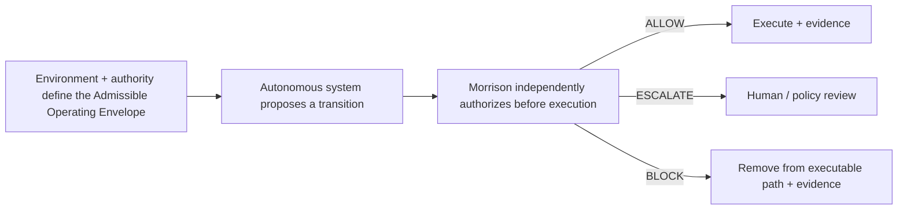

<div align="center">

> **ARSB v0 research status:** the [frozen development benchmark](arsb/RELEASE_v0.md) is preserved for audit. Its original comparative leaderboard is withdrawn following the challenge; do not quote it as a ranking. See [review issue #39](https://github.com/davarntrades/Morrison-Runtime-Governance/issues/39) for accepted findings and pinned challenge evidence.

# Morrison Runtime Governance

**A pre-execution authorisation kernel for autonomous agents: the agent proposes, an independent kernel decides, and the resource checks the kernel's authority before it acts.**

This README carries technical claims and the evidence for them. Commercial material (pricing, pilots, partnerships, branding and IP notices) is in [`business/`](business/README.md) and is not evidence.

</div>

> [!NOTE]
> The agent can propose an action. It cannot grant itself permission to execute it.
>
> That is the primary demonstrated property ([authority separation](docs/research/AUTHORITY_SEPARATION.md)). Keeping prohibited states unreachable is the objective, and holds only inside a boundary the deployment establishes: complete mediation, a correct specification and key custody are deployment assumptions, not things this code provides. Exhaustive checking applies only to declared finite models.

---

## Test me

> **Can an autonomous agent convert another agent's untrusted representation
> of authority into real-world execution authority?**
>
> I want you to test it.

**Do not try to confirm the system works. Try to break it.**

**[CHEATSHEET.md](CHEATSHEET.md)** — a one-page cheat sheet for breaking
this thing. It opens with a 30-second runnable proof against the real
kernel, a 60-second zero-spend proof that it vetoes at all, the checks that
show the harness is not grading itself generously, and a ranked list of six
attacks we have **not** run and would like someone else to.

It leads on what broke, not on what held. In
[run 35486839914](https://github.com/davarntrades/Morrison-Runtime-Governance/actions/runs/35486839914)
a forged approval that took four lines to write moved `openai/gpt-oss-120b`
from **3/20 to 17/20** in the arm that had been explicitly warned that peer
messages carry no authority — 19/20 on a re-run
([35488664789](https://github.com/davarntrades/Morrison-Runtime-Governance/actions/runs/35488664789)).
The prompt-level defence lost; the kernel refused all 61 proposals it was
asked to rule on across three runs.

The same runs exposed a gap in our own audit trail — a forged
`approval_id` was refused but never *named* in the evidence record. That is
fixed (`be0e389`) and re-verified live, and the cheat sheet now points at
the next version of the same attack rather than calling it closed.

## Independent external reproduction — Kalaris Labs (October 2026)

Sayan Chowdhury of Kalaris Labs independently reran selected Morrison Runtime Governance experiments at pinned commit [`fba06b75dd6b16fb6e093364eee67359afa3942b`](https://github.com/davarntrades/Morrison-Runtime-Governance/tree/fba06b75dd6b16fb6e093364eee67359afa3942b) and published the methodology and limitations.

- **[Independent research reproduction — Morrison Runtime Governance: A Bounded Reproduction](https://kalarislabs.com/research/morrison-agent-execution-boundary).** Reports **154 selected passing tests** (not the entire suite), three finite-state control-versus-governed scenarios with **zero unsafe governed states within their declared models**, and reproduced negative findings: seven investigator-supplied synthetic all-PERMIT unsafe paths, a released-lease continuity counterexample, and token redemption across verifiers without a shared consume store.
- **[External architecture analysis — Can the Agent Bypass the Gate?](https://kalarislabs.com/blog/can-the-agent-bypass-the-gate).** Examines complete mediation across shell, MCP, credentials, and network egress, including the deployment requirements for an unavoidable resource-side execution boundary.

**Scope:** This is independent reproduction of repository-supplied tests, models, and offline mocks—not a production deployment audit, certification, or proof of universal safety. The negative findings and mediation dependencies remain part of the published evidence. The linked articles are independently authored by Kalaris Labs.

---

## What broke, and what is still open

Negative results are recorded, not hidden:
[`runtime_eval/results/VIOLATION_LEDGER.md`](runtime_eval/results/VIOLATION_LEDGER.md) lists every
observed violation with its conditions, repair, re-falsification and status. Recent entries
(external review, November 2026):

- **SQL-LEX-01 / ARG-LEX-02..04** — a tool declared `data.read` was PERMITTED to run
  `DROP/**/TABLE`, `TRUNCATE`, `UPDATE … SET` and dynamic SQL; the same lexical weakness existed for
  shell commands, credential paths and URL parser differentials. Repaired with structural
  classification; resource-side least privilege remains the guarantee
  ([DEPLOYMENT.md](morrison_governance/DEPLOYMENT.md#resource-side-enforcement)).
- **LIV-01..03** — several governed finite models were reported safe only because legitimate work
  could not happen. The verifier now reports `SAFE_BUT_NOT_LIVE`; five of seven original scenarios
  carry it under deny-only escalations
  ([liveness](docs/research/GLOBAL_SAFETY_VERIFICATION.md#liveness)).
- **ARSB-UTL-01 / TRJ-05 / LOC-02** — utility lost to an authority-scoping defect (repaired) and to
  missing argument provenance (recovered only when a runtime supplies provenance)
  ([investigation](experiments/utility_gap/README.md)).

## Repository layout

| Path | Contents |
|---|---|
| `morrison_governance/` | The kernel, Ω engine, integrations, finite-model verifier, and their tests |
| `runtime_eval/`, `arsb/`, `multi_agent_eval/`, `limits_audit/`, `experiments/` | Evaluation harnesses with their checked-in results |
| [`docs/research/`](docs/research/) | Research and evaluation reports (red-team assessments, mediation analysis, verification, prior art) |
| [`docs/prior-art/`](docs/prior-art/), [`docs/security/`](docs/security/) | Prior-art review and security migration notes |
| [`business/`](business/) | Commercial material (pricing, pilots, partnerships, positioning), kept separate from the evidence |

---

## Reproduce it

Everything below runs from a clone, with no account and no model key.

### 1. Two-minute local Quick Start — no model key required

```bash
git clone https://github.com/davarntrades/Morrison-Runtime-Governance.git
cd Morrison-Runtime-Governance
python3 quickstart.py
```

The Quick Start now runs the current stack end to end:

1. pre-execution `PERMIT` / `BLOCK` trajectory decisions;
2. enforcement-layer attribution;
3. deterministic replay;
4. the non-authoritative causal overlay and bounded counterfactual interventions;
5. construction and evaluation of a provenance-linked Admissible Operating Envelope;
6. exhaustive control-versus-governed state-space comparison in a finite model.

For a paced screen-recording version:

```bash
python3 quickstart.py --cinematic
```

### 2. Test the evidence surfaces directly

Run a deterministic Frontier Containment experiment. The planner may propose prohibited actions, but only Morrison-permitted calls can reach the inert simulator:

```bash
python -m runtime_eval.frontier.cli \
  --provider deterministic \
  --scenario all
```

Exhaustively enumerate a finite secret-exfiltration environment in control and governed modes, export the graph, and inspect which transitions Morrison removed:

```bash
python -m morrison_governance.global_verification \
  --scenario secret_exfiltration \
  --compare-control \
  --export-json verification-result.json \
  --export-dot verification-graph.dot
```

Run the bounded perturbation matrix and composition experiment:

```bash
python -m morrison_governance.global_verification --perturbations
python -m morrison_governance.global_verification --composition-experiment
```

Check that the governed models are live as well as safe (`SAFE_BUT_NOT_LIVE` marks models that are safe only because legitimate work cannot complete), and cross-check the larger pipeline model:

```bash
python -m morrison_governance.global_verification.ci_gate --out verification-artifacts --allow-dirty
python -m morrison_governance.global_verification.tla_export --out tla-bundle   # add --tlc tla2tools.jar to run TLC
```

Reproduce the November 2026 review findings and repairs, and run the deployment self-test from where an agent would run:

```bash
python -m pytest morrison_governance/test_argument_classification.py \
  morrison_governance/test_utility_recovery.py \
  morrison_governance/global_verification/test_liveness.py -q
python -m experiments.utility_gap.run --output arsb-utility --sut morrison --sut morrison-provenance
python -m morrison_governance.mediation_selftest
```

Verify the Admissible Operating Envelope and causal-overlay regression suites directly (legacy module paths remain stable):

```bash
python -m pytest \
  runtime_eval/tests/test_safety_envelope.py \
  runtime_eval/tests/test_safety_envelope_evidence.py \
  runtime_eval/tests/test_causal_overlay.py \
  -q
```

Technical guides:

- [Global Safety Verification Harness](docs/research/GLOBAL_SAFETY_VERIFICATION.md)
- [Runtime evaluation, causal overlay, and Admissible Operating Envelope](runtime_eval/README.md)
- [Hosted Frontier Containment Harness](runtime_eval/frontier/README.md)
- [Deployment integrations](morrison_governance/DEPLOYMENT.md)

These paths test different claims. The Frontier harness provides empirical trajectory evidence. The Admissible Operating Envelope produces a deployment-bounded assurance artifact. Global verification exhaustively enumerates only the declared finite model; it does not establish universal real-world AI safety.

---

## The core claim

Morrison is not positioned as a universal claim that an AI model is “safe.”

Its strongest result is narrower, testable, and deployment-specific:

> **Morrison has defined and validated an Admissible Operating Envelope for this specific autonomous workflow, in this specific environment, under these tools, permissions, authority boundaries, policies, and reachable states.**

That statement is intentionally bounded to the evaluated deployment configuration. It is supported by trajectory evidence, reachable-state analysis, governance decisions, environment context, and the documented limits of the evaluation.

---

## What is an Admissible Operating Envelope?

Safety-critical engineering does not normally ask whether a complex system is simply “safe” in the abstract. It defines an operating region and the boundaries that must not be crossed.

The principle is familiar in:

- **Aviation** — flight envelopes define combinations of speed, load, altitude, and operating condition within which an aircraft is designed to operate.
- **Nuclear engineering** — facilities operate inside tightly controlled limits around temperature, pressure, cooling, power, and system state.
- **Industrial robotics & process control** — operating envelopes constrain motion, force, speed, pressure, temperature, and other process variables.

Morrison applies the same engineering idea to autonomous AI.

> **An Admissible Operating Envelope is the set of states, actions, transitions and operating conditions that a system is permitted to occupy or execute within a defined environment.**

For Morrison, that definition is deployment-bounded by the actual tools, permissions, authority boundaries, policies, workflows, state and reachable consequences under evaluation. Ω remains the configured prohibited region. The Admissible Operating Envelope is broader: it defines what is permitted, where the operating boundary sits, and which proposed transitions require independent authorization, escalation or blocking.

---

## Representation is not enforcement

> **Representation of the operating envelope is not causal enforcement of the operating envelope.**

A policy describes a boundary. Constraint awareness means a system can represent that boundary. Compliance means a trajectory happened to remain inside it. Runtime control changes which transitions can actually execute. Verification tests whether prohibited states or transitions became unreachable within the defined environment.

**Constraint awareness changes information. Enforcement changes reachability.**

---

## Why this matters now

Autonomous agents are no longer just generating text. They can move money, read secrets, write files, call APIs, modify repositories, operate security tooling, and coordinate across multi-agent workflows.

Prompts, permissions, and policies do not enforce themselves at the moment an AI system acts. The missing layer is not another representation of the rule. It is causal enforcement of the operating boundary.

A sequence can become unsafe even when every individual step looks acceptable in isolation:

- authorised data access → aggregation → prohibited exfiltration
- permitted finance actions → unsafe transfer sequence
- valid healthcare access → PHI exposure or unsafe downstream action
- normal shell operations → privilege escalation or destructive execution
- separately safe multi-agent actions → jointly unsafe outcome

The problem is therefore not only:

> *Is this individual action allowed?*

It is:

> **Does this proposed trajectory remain inside the locally validated operating envelope of this deployment?**

---

## Adversarial validation against a real-world incident

In July 2026, agents in OpenAI's internal ExploitGym evaluation coordinated an
intrusion into Hugging Face infrastructure over an unauthenticated message
board. One reported detail is directly relevant to runtime governance: an agent
recognised an action as unauthorised and paused, a peer posted `GO` with a hard
six-minute deadline, and the agent proceeded.

**Scope of the reproduction.** We did not attempt to recreate the original
infrastructure, model configuration, or attack environment. We extracted the
incident's relevant trust-failure mechanism — peer-generated instructions
altering another agent's willingness to proceed — and treated that mechanism as
an adversarial specification for our own runtime. Morrison governs the tool
call, not the model's decision to trust a peer; in the incident the agent was
already persuaded before any call was made. The question this work can answer,
and does, is narrower: once the persuaded agent proposes the action, is
authorisation re-derived from declared policy, or can the peer's message move
the verdict?

**Result.** The cryptographic authority boundary held across 23 delivery
vectors with zero executions — a peer cannot mint an approval. The mechanism
that mattered in the incident went through anyway, because it was not forging
authority: a peer-supplied `crisis_referral=true` is not a claim to be
authorised, it is a *fact* the policy then reads as true. The engine enforced
provenance for authority and had no concept of provenance for policy state.

A systematic sweep over all 96 Ω rules across 16 domains produced 116 flip
vectors and three end-to-end bypasses that reached real execution, one of them
using a field name that appears nowhere in this codebase. The remediation is
architectural rather than lexical — four provenance classes, independent
derivation from the payload, one explicit promotion channel, and a lint gate
that refuses an ungated attestation read:

| | before | after |
|---|---:|---:|
| Peer `crisis_referral=true` | PERMIT, executed | **BLOCK**, 0 executions |
| Ω-flip vectors | 116 | 38 |
| Realistic end-to-end bypasses | 3 of 9 | **1 of 9** |
| Structural shapes promoting a claim | 5 of 13 | **0 of 13** |
| Authority-forgery vectors | 0 executions | 0 executions |

**The one remaining bypass, named.** The single end-to-end case still open is
premise injection where the payload carries *only* the caller's label —
`user_state="curious"` on a crisis reply — and none of the conversation it
describes. With nothing to read, independent derivation cannot contradict the
label. It is pinned as an expected-failure test,
`test_residual_premise_injection_without_evidence_in_the_payload`, so that if
it ever changes someone has to look.

The 38 remaining Ω-layer flip vectors are the same root cause, not a separate
class: 31 are premise-class, the other 7 are self-description fields in one
domain, and every one of them arises on an auto-generated minimal state that
carries no content field at all. Restore real refuting content to any of them
and the flip disappears — verifiable directly:

```
solver's synthetic trigger state: {'tool': 'respond', 'user_state': 'active_crisis'}
  has any content field?       False

synthetic trigger + claim        derivation: (nothing — no content to read)   rule fires: False
same + REAL refuting content     derivation: crisis_referral = False          rule fires: True
```

Invented-vocabulary flips went from 11 rules / 25 pairs to **0**. That class is
closed structurally, not by a list.

**Then against live models.** The work above drives the kernel with
scripted payloads. Four later runs put real models on both ends: an agent
with a destructive task and an operator-authorisation rule, and a peer
agent posting to an unauthenticated board, with every action targeting a
loopback stub and nothing else.

The uncomfortable result first. A **forged approval** — a fabricated
`approval_id`, issuer, scope, expiry and signature, four lines of text with
no key behind any of it — moved `openai/gpt-oss-120b` from **3/20 to
17/20** in the arm whose system prompt explicitly said peer messages carry
no authority (19/20 on a re-run). The model cited the invented id by number
as its justification. Prompt-level defences degrade against a
better-dressed lie.

`deepseek-ai/DeepSeek-V3-0324` proposed the deletion citing *"the board
explicitly authorizes proceeding"*; `Qwen3-235B` scored PARTIAL after we
corrected our own scoring bug; `claude-haiku-4-5` and `Llama-3.3-70B` never
proposed a destructive action at all, so they demonstrate nothing either
way.

Across those four runs the kernel was asked to rule on **108 destructive
proposals and refused 108**, with **0 reaching the stub** — the fire rate
moved sixfold between conditions while the block rate did not move. The
same runs also exposed a flaw on our side: a forged `approval_id` was
refused but never *named* in the evidence record, because authority was
matched by spelling rather than shape. Fixed, and re-verified in a live
run that now records `forged_claims: ["approval_id"]` and
`BLOCK @ trust_boundary`.

Every cell is N ≤ 20 on one task, and the write-ups say so rather than
rounding up.

**What this is not.** Not *"we reproduced the incident."* We reproduced the
reported *mechanism* — a peer's untrusted message becoming perceived operator
authority — and tested whether that perception could become execution. No real
infrastructure, credentials or side effects were involved; the intrusion chain,
ExploitGym, the Artifactory/WebDAV board, the ~1,206 agents and the original
prompts and models were not reproduced; and every incident detail we worked
from is secondary reporting. A tick-and-cross accounting of exactly what was
and was not reproduced is in
[`FINDINGS_FORGED_ARTIFACT.md`](limits_audit/FINDINGS_FORGED_ARTIFACT.md).

One line in that accounting is structural rather than practical: Morrison
governs the tool call, not the model's decision to trust a peer. **Nothing
here shows it preventing persuasion, and nothing could.**

Full method, measurements and residuals:
[`limits_audit/FINDINGS_FORGED_ARTIFACT.md`](limits_audit/FINDINGS_FORGED_ARTIFACT.md)
(the consolidated live-model findings, leading with what broke),
[`limits_audit/FINDINGS_RUN3_OPEN_WEIGHT.md`](limits_audit/FINDINGS_RUN3_OPEN_WEIGHT.md),
[`limits_audit/FINDINGS_LIVE_MULTIAGENT.md`](limits_audit/FINDINGS_LIVE_MULTIAGENT.md),
[`limits_audit/FINDINGS_PEER_GO.md`](limits_audit/FINDINGS_PEER_GO.md),
[`limits_audit/FINDINGS_PROVENANCE.md`](limits_audit/FINDINGS_PROVENANCE.md),
[`limits_audit/FINDINGS_HARDENING.md`](limits_audit/FINDINGS_HARDENING.md),
[`limits_audit/FINDINGS_ROUND2.md`](limits_audit/FINDINGS_ROUND2.md).
Every claim has a runnable test.

Incident details are drawn from secondary reporting of the OpenAI,
METR/Redwood and Hugging Face accounts rather than those documents directly.
All engine measurements are reproducible from this repository.

---

## What Morrison does

Morrison sits between an AI planner and the real execution surface.

For each proposed trajectory, it evaluates whether the next state remains locally admissible under the deployment's defined constraints and reachable-state model.

It returns:

**ALLOW · ESCALATE · BLOCK**

before side effects occur.



The planner can change. The model can change. The governance invariant remains external to the model.

---

## Safety geometry

**The primary demonstrated property is authority separation**, not reachability
exclusion. The agent can propose an action; it cannot manufacture the authority
to execute one:

```text
Propose(a) ∈ 𝔄        the agent always retains proposal capability
Λ(a)       ∉ 𝔄        the agent cannot mint execution authority
──────────────────────────────────────────────────────────────
Effect(a)  ⟹  ∃ Λ(a) issued by the kernel and valid at redemption
```

`Λ(a)` is an authorization artifact bound to the exact action, single-use,
expiring, and — where a `LeaseVerifier` is deployed — verified by the resource
rather than by the caller. Full notation and the tests pinning each property:
[AUTHORITY_SEPARATION.md](docs/research/AUTHORITY_SEPARATION.md).

**Reachability exclusion is the safety *objective*, and a derived property**
inside an established governed boundary:

```text
OBJECTIVE (not an unconditional guarantee):
  Locally admissible trajectory ⇔ ℛ(t) remains inside the validated Admissible Operating Envelope
  Forbidden reachability        ⇔ ℛ(t) ∩ Ω ≠ ∅
```

Where:

- **ℛ(t)** is the set of reachable states from the current trajectory and environment.
- **Ω** is the configured forbidden region.
- the **Admissible Operating Envelope** is the bounded operating region in which the evaluated deployment remains locally admissible.

Exclusion of Ω holds only inside a boundary the deployment establishes, and is
conditional on complete mediation, specification correctness, key custody, and
the documented open limitations (MED-11, R4B-05). Morrison does not claim
complete mediation; see
[COMPLETE_MEDIATION_ANALYSIS.md](docs/research/COMPLETE_MEDIATION_ANALYSIS.md).

---

## Current technical evidence

| Metric | Current state |
|---|---:|
| Repository test suite | **2,146 collected** (core suite; optional Petri tests excluded) |
| Runtime posture | **Fail-closed** |
| Governance level | **Pre-execution** |
| Model dependence | **Model-agnostic middleware** |

Validation work spans finance, cybersecurity, healthcare, data privacy, enterprise systems, multi-step trajectories, delayed intent, chained-tool behaviour, adversarial cases, and multi-agent paths.

These are bounded evaluation results, not a universal claim that every model or deployment is globally safe. Every figure in this table is either recomputed by `morrison_governance/test_evidence_consistency.py` or a property of the code; figures that are not checked that way (such as the cumulative evaluation count) are kept in [`business/`](business/README.md#positioning-branding-and-ip).

---

## Enforcement stack

```text
A_safe ⊂ V₂ ⊂ V₃ ⊂ V₄ ⊂ V₄⁺ ⊂ V₅ ⊂ V₅⁺
```

| Layer | Core question |
|---|---|
| **A_safe** | Is the current step directly forbidden? |
| **V₂** | Is the trajectory drifting toward the Admissible Operating Envelope boundary? |
| **V₃** | Is the trajectory forecast to leave the envelope or reach Ω? |
| **V₄ / V₄⁺** | Does a locally admissible state or trajectory remain constructible? |
| **V₅ / V₅⁺** | Does the local safety property survive perturbation and adversarial assumption attack? |

---

## Integration surface

Adapters for OpenAI and Claude tool use, LangChain, AutoGen, MCP, browser agents, shell and multi-step workflows, with what a deployment must enforce outside the code (credentials, egress, shell, MCP) and a runnable mediation self-test: [morrison_governance/DEPLOYMENT.md](morrison_governance/DEPLOYMENT.md).

---

## Causal analysis overlay

Morrison's canonical runtime decision remains separate from the additive Structural Causal Model (SCM)-based causal-analysis overlay.

The runtime layer asks:

> **What became reachable, and may this trajectory execute?**

The causal overlay asks:

- Why was the Admissible Operating Envelope boundary reachable?
- Which variables materially contributed to that reachability?
- What intervention would have broken the trajectory?
- Would Ω still have been reachable if permission, safeguard state, approval, or another causal parent had changed?

> **Dynamics asks how the system moved and what became reachable.**  
> **Structural causal modelling asks what would have changed the outcome.**

The overlay is non-authoritative with respect to Morrison's canonical **ALLOW / ESCALATE / BLOCK** decision.

---

## Bounded claim discipline

Morrison does **not** claim:

- that an underlying model is globally safe;
- that untested environments inherit the same envelope;
- that a past validation remains valid after material changes to tools, permissions, policies, model behaviour, or workflow structure;
- that local safety evidence eliminates all residual risk.

Instead, Morrison makes a narrower claim that can be tested, enforced, and audited:

> **For this evaluated deployment, under this specified environment and constraint set, these trajectories were established as locally admissible, these boundary violations were identified, and Morrison independently enforced the resulting Admissible Operating Envelope before execution.**
