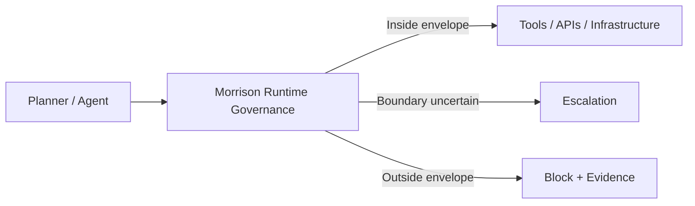

# Commercial material

Pricing, pilot offers, partnerships and positioning for Morrison Runtime Governance, kept out of the
research README so the evidence can be read on its own. Nothing here is evidence: every technical
claim should be checked against the [repository README](../README.md) and the
[violation ledger](../runtime_eval/results/VIOLATION_LEDGER.md).

| Document | Purpose |
|---|---|
| [Enterprise overview](ENTERPRISE.md) | Product overview for enterprise readers |
| [Enterprise pilot](<Morrison Runtime Governance — Enterprise Pilot.md>) | Pilot structure |
| [48-hour runtime safety audit](<48-Hour Runtime Safety Audit.md>) | Fixed-scope assessment offer |
| [Pricing strategy](<Pricing Strategy.md>) | Pricing |
| [Domain strategy](<Domain Strategy.md>) | Domain expansion |
| [Partnerships](README_PARTNERSHIPS.md) | Partner and collaborator framework |
| [Infrastructure overview](<deployable infrastructure repository.md>) | Deployable-infrastructure pitch |

---

## Positioning, branding and IP

Moved here from the research README so that badges and notices are not read as evidence.

_∩_Ω_=_∅-0075ca?style=flat-square)

- **Name:** Morrison Runtime Governance™.
- **Tagline:** Admissible Operating Envelopes for autonomous systems — defined, tested, and enforced before execution.
- **Patent:** UK GB2600765.8 (the package header also lists GB2602013.1, GB2602072.7 and GB2602332.5). A patent filing is not evidence that a technical claim holds; see the [prior-art position](../docs/research/PRIOR_ART_AND_NOVELTY_POSITION.md).
- **Governance evaluations: 129,857.** A cumulative count of governance decisions across evaluation runs. It is not recomputed by the evidence-consistency tests and does not distinguish passing from failing evaluations, so it is not quoted in the research README.
- **"ℛ(t) ∩ Ω = ∅"** is the safety *objective*, not a demonstrated guarantee; see [authority separation](../docs/research/AUTHORITY_SEPARATION.md).

---

## Hosted console

- **[Live trajectory console](https://www.resurrection-tech.com/live-demo)** — paste your own tool-call sequence and receive the real pre-execution verdict, layer, reason, and downloadable audit trail.
- **[Test without your own agent](https://www.resurrection-tech.com/test-without-agent)** — run prepared agent scenarios or type a task and inspect the proposed trajectory before Morrison evaluates it.

The public console inspects proposed actions only. It does not execute the submitted workflow or expose a production credential in the browser.

---

## What makes the approach different

### Environment-specific
The claim is tied to the actual deployment: its tools, permissions, policies, workflows, state, and reachable consequences.

### Trajectory-level
Morrison evaluates the path through the system, not only the latest prompt, output, or individual tool call.

### Pre-execution
The governance decision occurs before the proposed action reaches the real execution surface.

### Bounded evidence
Morrison records what was evaluated, which envelope and constraints applied, what was allowed, escalated, or blocked, and the limits of the local safety claim.

### Model-agnostic
The governance layer sits outside the model and does not require model retraining or access to model weights.

---

## What a deployment should be able to show

A useful enterprise result should not end with a generic “safe / unsafe” label.

It should expose the scope of the claim:

- **Autonomous workflow** evaluated
- **Model / agent configuration**
- **Connected tools and APIs**
- **Permissions and trust boundaries**
- **Policies and constraints**
- **Reachability horizon / state model**
- **Ω definition**
- **Inside-envelope trajectories**
- **Boundary violations**
- **ALLOW / ESCALATE / BLOCK evidence**
- **Known limitations and untested conditions**

A deployment-level conclusion can then be stated clearly:

> **Morrison has defined and validated an Admissible Operating Envelope for this specific autonomous workflow, in this specific environment, under these tools, permissions, authority boundaries, policies, and reachable states.**

That is the assurance artifact Morrison is designed to produce and enforce.

---

## Enterprise evaluation path

The commercial entry point is no longer only “find catastrophic actions.”

It is to establish the deployment's local operating boundary and prove where autonomous operation remains admissible.

### Operating Envelope Assessment
A bounded assessment of the deployment's environment, architecture, tools, permissions, authority boundaries, policies, reachable states, prohibited region Ω, and constraints.

### Shadow Mode / Limited Pilot
Observe live or sandboxed trajectories without enforcing, and show which remain inside the envelope, approach the boundary, or would leave it.

### Guarded / Enforced Pilot
Apply **ALLOW / ESCALATE / BLOCK** before execution and preserve evidence of every governed decision.

### Enterprise Integration
Continuously revalidate the Admissible Operating Envelope as models, tools, permissions, workflows, and policies change.

The target proof is explicit:

> **Morrison has defined and validated an Admissible Operating Envelope for this specific autonomous workflow, in this specific environment, under these tools, permissions, authority boundaries, policies, and reachable states.**

---

## Enterprise risk coverage

The current evaluation surface includes classes such as:

- unauthorised financial execution
- credential / secret exfiltration
- shell injection / RCE
- privilege escalation
- path traversal / sandbox escape
- PII / PHI leakage
- chained and delayed multi-step attacks
- multi-agent collusion and cross-agent delayed intent
- malformed or semantically disguised tool calls
- encoded payloads and nested delegation
- long-horizon agent drift
- environment-sensitive safety under perturbation
- replay and evidence ambiguity
- schema-malformation bypass
- cross-domain Ω reachability
- stochastic planner divergence

Detailed implementation and evaluation artefacts live throughout this repository.

---

## The positioning in one sentence

> **Define the Admissible Operating Envelope. Evaluate proposed transitions. Authorize independently. Enforce before execution. Verify what became unreachable.**

---

## Integration surface

Morrison is designed to sit at the action boundary across agent frameworks and enterprise workflows, including:

- OpenAI tool/function calling
- Anthropic / Claude tool use
- LangChain / LangGraph-style orchestration
- AutoGen
- MCP
- browser agents
- shell / subprocess execution
- custom enterprise workflows

---

### Resurrection Tech Ltd

**Admissible Operating Envelopes for autonomous systems · Runtime governance before execution · Evidence after every decision**

[Website](https://resurrection-tech.com) · [GitHub](https://github.com/davarntrades) · [LinkedIn](https://www.linkedin.com/in/davarn-morrison-14b93b263) · [Email](mailto:davarn@resurrection-tech.com)

